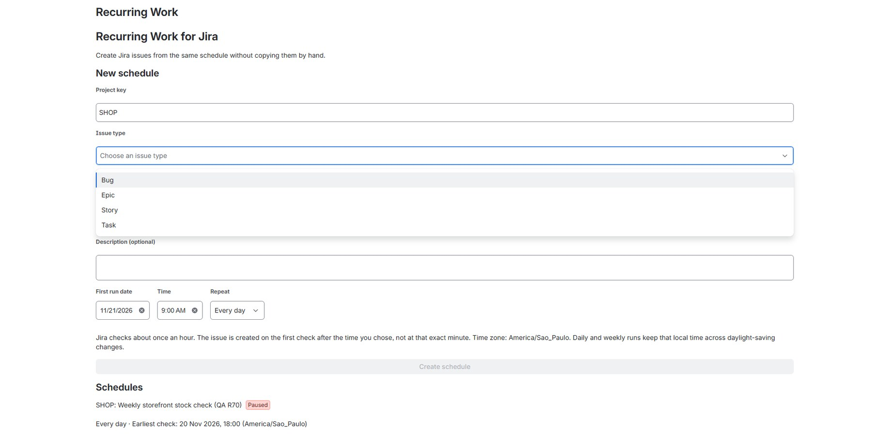

# Recurring Work for Jira

User guide and support for **Recurring Work for Jira**, an Atlassian Forge app that creates the same Jira work item on a daily, weekday, weekly, or monthly schedule.

## What it does

- Creates a new Jira issue from a schedule you set: project, issue type, summary, and description.
- Repeats daily, Monday to Friday, weekly, or monthly.
- Keeps the local run time you chose, including across daylight-saving changes, and goes back to the 29th, 30th, or 31st after a shorter month.
- Looks for the issue it would create before creating it, so a retry after a Jira error does not duplicate work.
- Retries a failed run on later hourly checks, up to five times, then pauses the schedule and shows the last error.
- Runs entirely on Atlassian's Forge platform. We have no servers for it.

## Set up a schedule

1. In Jira, open **Apps > Recurring Work**.
2. Type the project key (for example `OPS`). The issue type list fills with the types that project can create. Pick one by name. Subtasks stay off the list, because a schedule has no parent issue.
3. Write the issue summary and, if you want, the description that every run will copy.
4. Pick the first run date and time, and how often it repeats.
5. Select **Create schedule**. The app checks about once an hour. The first issue is created on the first check after the time you chose, and the list then shows the last run or the error.

You can pause or remove a schedule at any time from the same page. A schedule belongs to the whole Jira site, so every schedule is visible to people who can open the app.

## What Create schedule tells you

Production and development, deployed 20 November 2026, answer Create schedule with "Schedule created." and this note, which also sits under the time field: "Jira checks about once an hour. The issue is created on the first check after the time you chose, not at that exact minute."

A weekday schedule refuses a Saturday or Sunday first run and keeps Create schedule disabled until the first date is Monday through Friday. The message is: "Weekday schedules start on Monday through Friday. Choose a weekday for the first run."

On 20 November 2026 a development install, which is not a Marketplace install, showed that message for a first run of 21 November 2026 (a Saturday) and left Create schedule disabled. The same screen showed the hourly note.

## What the list shows

Under each schedule the line uses the schedule's own time zone. For the worked example's next check it reads:

`Every day · Earliest check: 20 Nov 2026, 18:00 (America/Sao_Paulo)`

That time is the earliest moment the hourly check may create the issue. On 20 November 2026 the paused SHOP-8 row on the development install showed that line, with Last run "Already created: SHOP-8" and status Paused. That check did not resume, delete, or create another schedule.

The crop below is that screen without the Jira sidebar or the account bar. It ends on the earliest-check line because the window cut off the Last run line.

## When the last error does not name a field

The schedule shows the last error after a failed check. If that text does not name the field Jira rejected, open the project and start one issue of the same type. The create screen lists required fields this app does not ask for, such as priority. Make that field optional, or give it a default, then resume the schedule. Production deployed at 23:01 America/Sao_Paulo on 20 November 2026 sets that count back to zero. See [Resume after five failures](#resume-after-five-failures). A subtask fails for a different reason: the schedule has no parent issue, so choose a standard type instead.

## Resume after five failures

Each failed check adds one to a count stored on the schedule. At five, the schedule pauses and the last run reads `Paused after five failed attempts`.

Production deployed at 23:01 America/Sao_Paulo on 20 November 2026 sets the count to zero when you press Resume after at least one failure and sets the last run to `Resumed. The next hourly check tries again.` The last error stays, so a field name such as `priority` is still there. The following failed check is then retry 1 of 5, not an immediate pause. Resume of a schedule whose count is already zero leaves the last run as it was, including `Already created: SHOP-8`. The build from earlier that day turned the schedule back on and left the count at five. That screen was not opened again after the 23:01 deploy.

There is no public install link.

## Worked example

On 19 November 2026 a private Jira site used a development install, which is not a Marketplace install. The schedule was:

- Project `SHOP`, issue type Task (`10001`)
- Summary: `Weekly storefront stock check (QA R70)`
- Description: `QA run for Recurring Work: verify the scheduled issue is created once and the next run is scheduled.`
- Repeat: every day
- First run: 19 November 2026, 18:00, America/Sao_Paulo

The hourly check at 18:55 America/Sao_Paulo created issue `SHOP-8` at 18:55:49, reported by Recurring Work for Jira, with the label `recurring-mwo05iuczanla02h-mwo1ag00`. That check did not save the schedule row. After a fix to that save, the next check found the same label, left `SHOP-8` as the only matching issue, and saved `Last run: Already created: SHOP-8`. The next run shown was 20 November 2026, 18:00. The schedule was then paused so the private site would not open another task the next day.

The Marketplace listing is not published, so there is no public install link yet.

## A check that is late by whole days

One hourly check creates the oldest due item and sets the earliest check to the next slot still in the future. Slots between those two times are not created.

The figures below are the app's schedule calculation for a daily run at 18:00 in America/Sao_Paulo. The 19 November SHOP-8 run was 55 minutes late, so its next slot was the following day. This section does not describe that run.

- Due time: 18 November 2026, 18:00 (`2026-11-18T21:00:00.000Z`).
- The check is at 18:00 on 21 November 2026 (`2026-11-21T21:00:00.000Z`).
- The item is the 18 November occurrence. 19, 20, and 21 November are not created.
- The list then reads `Every day · Earliest check: 22 Nov 2026, 18:00 (America/Sao_Paulo)` (`2026-11-22T21:00:00.000Z`).

Production deployed at 23:01 America/Sao_Paulo on 20 November 2026 names the skipped dates in the schedule time zone. For this example the last run reads `Created: SHOP-12. No issues were created for 19 Nov 2026 through 21 Nov 2026.` The build from earlier that day read only `Created: KEY` or `Already created: KEY`. That screen was not opened again after the 23:01 deploy. If that oldest item is already there, the same dates follow `Already created: SHOP-12`. One missed day is singular: a check at 18:00 on 19 November reads `Created: SHOP-9. No issue was created for 19 Nov 2026.` A daily 23:30 America/Sao_Paulo run due on 18 November (`2026-11-19T02:30:00.000Z`), checked one day later (`2026-11-20T02:30:00.000Z`), names 19 November. That is the local date. The UTC date of that instant is 20 November, and the line does not use it. A check 55 minutes after 18:00 still reads `Created: SHOP-8`, and the next earliest check is 19 November 2026, 18:00 (`2026-11-19T21:00:00.000Z`).

Weekday, weekly, and monthly schedules use the same rule: a slot is omitted only when that single check jumps over it. A weekday schedule due Friday 20 November 2026 at 12:00 UTC, checked Wednesday 25 November at 12:00 UTC, reads `Created: SHOP-11. No issues were created for 23 Nov 2026 through 25 Nov 2026.` Saturday and Sunday are not in that range. There is no public install link.

## Choosing the issue type

The form lists type names. You do not type a numeric ID. The line under the list says: "The list is the types this project can create. Subtasks stay off the list because a schedule has no parent issue." The open list for project SHOP is in the crop under [What the list shows](#what-the-list-shows).

On 20 November 2026, project `SHOP` on the development install offered Bug, Epic, Story, and Task. No subtask. A project key Jira does not know stays on the form as Jira's own sentence. Typing `SHOPSHOP` showed: "Jira 404 reading issue types for SHOPSHOP. No project could be found with id or key 'SHOPSHOP'." Replacing it with `SHOP` loaded the type list.

Loading that list, and saving the schedule, both ask Jira as you whether you can create issues in the project. The app calls `/rest/api/3/mypermissions` for `CREATE_ISSUES` and stores the schedule only when `havePermission` is true. Otherwise the form says `You need permission to create issues in PROJECT.` The hourly run has no person present, so it creates the work item as the app. Production deployed at 23:01 America/Sao_Paulo on 20 November 2026 includes this check.

You do not paste an issue type ID into the app. To see the same names outside it, open this URL while you are signed in to that Jira site, and replace `OPS` with the project key:

`https://your-site.atlassian.net/rest/api/3/issue/createmeta?projectKeys=OPS&expand=projects.issuetypes`

Read `projects[].issuetypes[]`. A row with `subtask` true is left off the form. The name in the form is the name in that list.

If the body is `{"expand":"projects","projects":[]}`, that browser is not signed in to the site. On 19 November 2026, `https://dms-release-gate.atlassian.net/rest/api/3/issue/createmeta?projectKeys=SHOP&expand=projects.issuetypes` returned HTTP 200 with that empty list and no session. A signed-in page lists the types under `projects`.

## A 31st that comes back after February

A monthly schedule keeps the day you chose. A shorter month uses its last day, and the following month returns to the original day. The local time stays put when daylight-saving time starts. Weekday and weekly schedules use that same local clock.

This is the result of the app's schedule calculation for day 31 at 09:30 in America/New_York. 2027 is not a leap year, and US clocks spring forward on 14 March 2027.

- 31 January 2027, 09:30 (`2027-01-31T14:30:00.000Z`) is followed by 28 February 2027, 09:30 (`2027-02-28T14:30:00.000Z`). The list line is `Every month · Earliest check: 28 Feb 2027, 09:30 (America/New_York)`.
- That February check still remembers day 31, so the next one is 31 March 2027, 09:30 (`2027-03-31T13:30:00.000Z`). The list line is `Every month · Earliest check: 31 Mar 2027, 09:30 (America/New_York)`. The UTC hour moved from 14:30 to 13:30 because daylight-saving time had started. The local time stayed 09:30.

A weekday schedule does the same. Friday 12 March 2027, 09:30 America/New_York (`2027-03-12T14:30:00.000Z`) skips Saturday and Sunday. The next check is Monday 15 March 2027, 09:30 (`2027-03-15T13:30:00.000Z`), shown as `Weekdays · Earliest check: 15 Mar 2027, 09:30 (America/New_York)`.

Production deployed at 23:01 America/Sao_Paulo on 20 November 2026 says daily, weekday, weekly, and monthly runs keep that local time. The same build adds the return day on a short month: `Every month · Earliest check: 28 Feb 2027, 09:30 (America/New_York). Day 31 returns on 31 Mar 2027.` The March line stays the earliest-check line alone, because that check is already day 31. The screen photographed earlier on 20 November was the previous build. It said only daily and weekly runs keep that local time, and its February line stopped at the earliest check. That screen was not opened again after the 23:01 deploy. There is no public install link.

## Support

Open a ticket at <https://portal.designmastersolutions.com/submitticket.php> and include your Jira site name and the schedule's summary.

## Privacy and terms

The privacy page states what this app keeps on your own Jira site: the schedule (project key, issue type, summary, description, repetition, run dates, and the last outcome or error) and the Atlassian account ID of the person who created it. Typing a project key reads the issue types that project can create. At the scheduled time the app looks for an issue it already created for that run and, if there is none, creates one. Once a week it reports that creator account ID to Atlassian. If the account is closed, only that account ID is removed. The schedule and the work text stay.

- Privacy: <https://www.designmastersolutions.com/privacy.html#atlassian-apps>
- Terms: <https://www.designmastersolutions.com/terms.html>

## Who makes it

Design Master Solutions builds Jira and Confluence apps that stay inside Atlassian: <https://www.designmastersolutions.com>.
